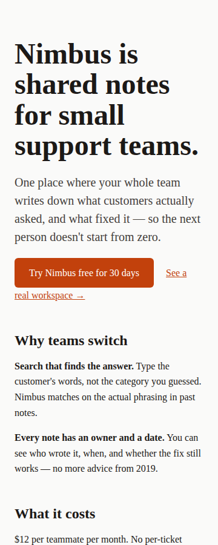
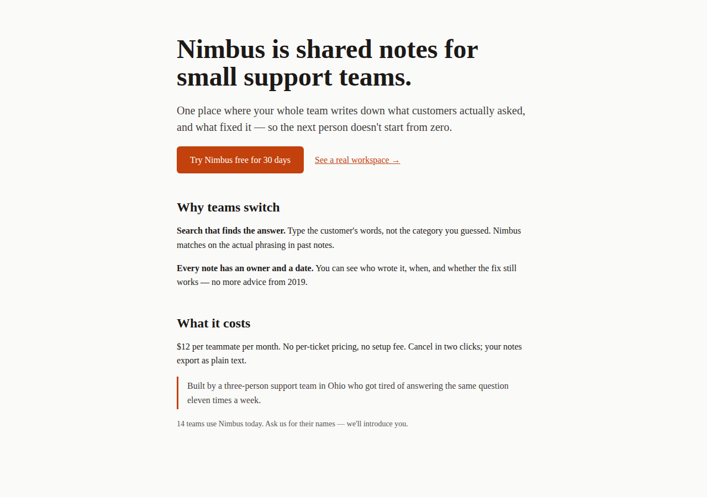

<div align="center">

# anti-ai-slop-design

**Stop AI from shipping UI that looks like AI made it.**

Most AI-generated interfaces look the same — same gradient, same font, same three cards — and users can tell in under a second. This skill teaches the agent to spot the tells, pick a real visual direction, and run a check on its own output before it calls the work done.

**🚀 [Try the live demo — see the difference in seconds](https://smabdulmueid97.github.io/anti-ai-slop-design/examples/fixed.html)**

Open [`examples/slop.html`](examples/slop.html) and [`examples/fixed.html`](examples/fixed.html) side by side: same page, one sloppy, one fixed.

[](https://github.com/smabdulmueid97/anti-ai-slop-design/blob/main/LICENSE)
[](https://github.com/smabdulmueid97/anti-ai-slop-design/stargazers)
[](https://github.com/smabdulmueid97/anti-ai-slop-design/commits/main)

</div>

---

## Screenshots

| Mobile | Desktop |
|---|---|
|  |  |

> Tested at 360 / 768 / 1280 px — no horizontal overflow, no clipped buttons.

---

## The tells it kills

- Violet-to-blue gradients used as the whole identity
- Inter as the only font, at default weights and sizes
- The default layout: centered hero, three feature cards, stats band
- Eyebrow labels above every heading, tracked-out uppercase everywhere
- Big-number stat blocks with no source
- Glassmorphism on everything, rounded-square icons above every heading
- Generic stock imagery and empty decorative frames
- Copy full of delve, elevate, unlock, seamless, supercharge
- Emoji bullets instead of real points
- Content hidden at `opacity: 0` until JavaScript reveals it

## What's inside

| File | What it is |
|---|---|
| `SKILL.md` | The skill: the tells, the fix process (direction first, then design rules, then the review pass), and a 20-item slop checklist |
| `scripts/slop-check.py` | A small deterministic checker (Python, no dependencies). Scans HTML/CSS for the mechanical tells, prints PASS/FAIL per check with file and line number |
| `examples/slop.html` | A deliberately sloppy AI-default landing page |
| `examples/fixed.html` | The same page redesigned following the skill's rules — open both, the difference is visible in seconds |

## How the skill works

1. **Pick a real direction first** — one distinctive typeface pairing, one restrained palette with a real accent, real content before layout.
2. **Design rules** — type scale, spacing, contrast minimums, one accent only, no gradient as a crutch, real photos or honest illustration instead of generic stock, copy that says something specific.
3. **Slop check** — run the 20-item checklist on your own output before you finish.

## Install

Copy this folder into your Claude Code skills directory, or add it with:

```bash
claude skills add /path/to/anti-ai-slop-design
```

Then invoke it before building UI:

```
/anti-ai-slop-design
```

Or paste the checklist from `SKILL.md` into a review prompt and ask the agent to score its own output, then fix every failure.

## Run the checker

```bash
python scripts/slop-check.py examples/slop.html examples/fixed.html
```

`slop.html` fails with a list of tells; `fixed.html` passes. The checker catches the mechanical tells — the checklist in `SKILL.md` catches the judgement ones. Use both.

## Before / after

- **Before** (`examples/slop.html`): purple-blue gradient hero, Inter everywhere, eyebrow label, three glass cards with emoji bullets, unsourced "10,000+ users" stats, content hidden until JS runs.
- **After** (`examples/fixed.html`): one distinctive typeface pairing (Fraunces + Newsreader), one accent colour, real words first, concrete pricing, a named team behind it, visible without JavaScript.

## License

MIT — see `LICENSE`.
